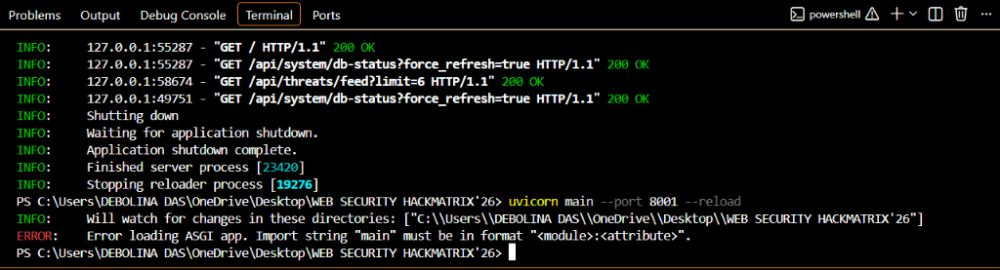
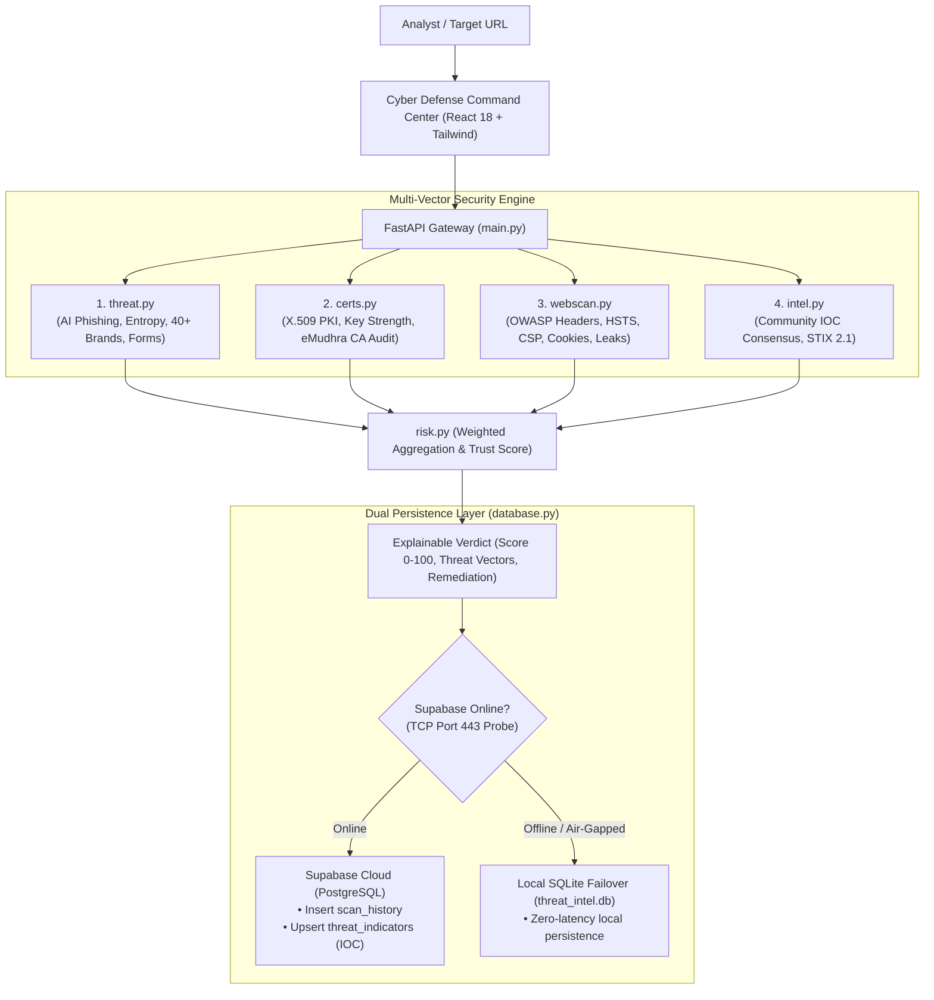
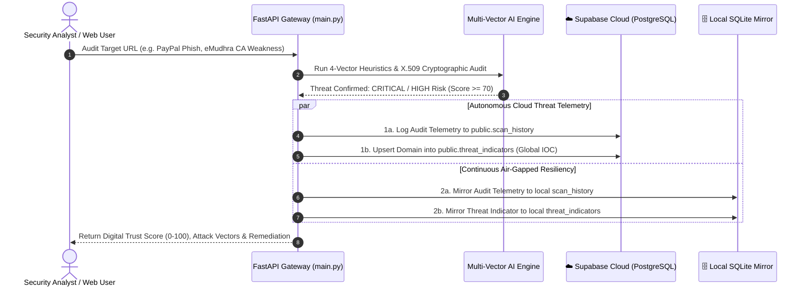

# ThreatGuard.AI

> **An AI-powered multi-vector cyber threat detection and digital trust intelligence platform evaluating phishing heuristics, X.509 cryptography, server posture, and collaborative threat intelligence with hybrid cloud and air-gapped resilience.**

---

## 1. Project Name & Description
**ThreatGuard.AI** is an advanced Web Threat Intelligence and Digital Trust platform built for **HackMatrix'26**. It evaluates URLs and digital assets across four critical attack vectors: **brand spoofing & phishing heuristics**, **X.509 cryptographic PKI validation (including the historic eMudhra CA incident)**, **OWASP web security posture**, and **collaborative threat intelligence**. It generates an explainable **Digital Trust Score (0–100)** and exports enterprise-ready **STIX 2.1** threat bundles.

---

## 2. Problem
1. **The Green Padlock Illusion**: Attackers easily obtain free TLS certificates (e.g., Let's Encrypt), misleading non-technical users into believing a malicious phishing site is "safe" simply because an HTTPS lock icon appears.
2. **Zero-Day Phishing & Homograph Impersonation**: Traditional static blocklists and domain blacklists fail against newly registered domains, Punycode/IDN character substitutions (e.g., Cyrillic `а` for Latin `a`), and algorithmically generated domains (DGA).
3. **Cryptographic Weaknesses & CA Incidents**: Compromised or improperly configured Certificate Authorities (such as the historic **eMudhra TLS incident**) can issue weak 1024-bit RSA certificates or untrusted intermediate certificates, enabling Man-In-The-Middle (MITM) inspection without triggering standard browser errors.
4. **Air-Gapped & Restricted Environments**: Modern SOCs and defense setups often operate in restricted or air-gapped networks where cloud-only threat intelligence tools fail completely.

---

## 3. Solution
ThreatGuard.AI provides a unified, explainable defense layer:
- **Weighted Multi-Vector Risk Engine**: Combines Phishing Heuristics (35%), X.509 Cryptography (25%), Web Posture (20%), and Collaborative Intel (20%) to compute an explainable **Digital Trust Score (0 to 100)** and categorical risk level (`CRITICAL`, `HIGH`, `MODERATE`, `LOW`, `CLEAN`).
- **Autonomous IOC Propagation**: When a high-risk or phishing domain is identified (Risk Score $\ge 70$), ThreatGuard **automatically promotes and upserts the domain into the Supabase Global Threat Indicators (IOC) table**. Threat telemetry is immediately shared with all analysts globally in real time.
- **eMudhra CA Incident Intelligence**: Deep cryptographic analysis inspecting RSA key lengths (< 2048-bit flagged as critical), Certificate Transparency (CT) Signed Certificate Timestamps (SCTs), SHA-1 deprecation, and rogue intermediate CAs.
- **Lexical & Shannon Entropy Heuristics**: Calculates domain randomness, Levenshtein distance against 40+ high-value target brands (PayPal, Chase, Amazon, Microsoft, eMudhra), and scans for unencrypted credential-harvesting forms.
- **Dual Persistence Architecture (Cloud & Air-Gapped Resiliency)**: Dynamically synchronizes threat intelligence to **Supabase PostgreSQL** when online, while using sub-second TCP socket probes to failover instantly to **local SQLite** in air-gapped or offline environments.
- **Enterprise SIEM Integration**: One-click generation and download of machine-readable **OASIS STIX 2.1** threat bundles for Splunk, Microsoft Sentinel, and MISP ingestion.

---

## 4. Demo Links & Screenshot

- **Local Web Command Center**: [http://localhost:8001](http://localhost:8001)
- **Interactive OpenAPI / Swagger UI**: [http://localhost:8001/docs](http://localhost:8001/docs)
- **GitHub Repository**: [https://github.com/Deblina170/WEB-SECURITY-HACKMATRIX-26](https://github.com/Deblina170/WEB-SECURITY-HACKMATRIX-26)

### Dashboard Screenshot


---

## 5. Tech Stack

| Layer | Technologies |
| :--- | :--- |
| **Backend & API** | Python 3.10+, FastAPI, Uvicorn (ASGI), Pydantic v2 |
| **Cryptographic & Network Analysis** | `cryptography` (pyca/cryptography X.509 parser), `urllib3`, `requests`, Python `socket`, `ssl` |
| **Algorithms** | Shannon Entropy, Levenshtein Distance, Punycode IDN decoder, OWASP Header Grader |
| **Persistence (Dual Architecture)** | **Cloud:** Supabase (Managed PostgreSQL with Row-Level Security, Autonomous IOC Upserts, Real-Time Telemetry) <br> **Air-Gapped / Offline:** SQLite3 with sub-second TCP reachability probing and zero-latency failover |
| **Frontend UI** | React 18, Tailwind CSS, Lucide Icons, Cyberpunk Glassmorphism SOC design |
| **Standards & Specifications** | OASIS STIX 2.1 JSON, CA/B Forum 398-day validity, RFC 5280 (X.509 PKI) |

---

## 6. Architecture

### System Flow Diagram


### Autonomous Threat Ingestion & Supabase Cloud Flow


#### 🛡️ Supabase Fault-Tolerance & Resilience Architecture:
1. **Autonomous IOC Distribution**: As soon as an analyst uncovers a malicious domain, ThreatGuard automatically promotes the indicator to the cloud database (`threat_indicators`), protecting all other analysts globally without requiring manual submissions.
2. **Isolated Fault Boundaries**: All cloud operations (`scan_history` insert and `threat_indicators` upsert) are housed in separate error-handling boundaries. Cloud timeouts, 503 errors, or rate limits **never crash the server or abort an audit**.
3. **Sub-Second Heartbeat Probing**: A lightweight non-blocking TCP socket heartbeat checks Supabase reachability (1.2s timeout). When network isolation or an air-gapped environment is detected, ThreatGuard falls back to local SQLite with 0ms downtime.

### Module Structure
```
WEB-SECURITY-HACKMATRIX-26/
├── certs.py              # X.509 cryptography, CA validation, eMudhra audit, CT SCT logs
├── threat.py             # Phishing heuristics, brand spoofing, entropy, credential forms
├── webscan.py            # Web posture, OWASP security headers, cookie flags, tech leaks
├── risk.py               # Weighted multi-vector risk engine & explainable trust scoring
├── intel.py              # Collaborative threat feed & OASIS STIX 2.1 exporter
├── database.py           # Dual persistence (Supabase PostgreSQL + SQLite failover)
├── main.py               # FastAPI backend with /analyze, /api/threats, and static routes
├── network_utils.py      # Non-blocking async network & DNS socket helper
├── supabase_schema.sql   # Cloud PostgreSQL DDL schema & indexes
├── test_api.py           # Comprehensive automated verification suite (100% pass)
├── requirements.txt      # Project dependencies
├── .env.example          # Environment variables template
├── assets/               # Screenshots and UI visual assets
│   └── dashboard_screenshot.png
└── static/               # Cyber Defense Command Center Frontend
    ├── index.html        # Single-page dashboard application
    ├── style.css         # Dark cyberpunk styling & animations
    └── app.js            # Frontend reactive state & API integration
```

---

## 7. Setup and Run Steps

### Prerequisites
- Python 3.10 or higher
- Git

### Installation
```bash
# 1. Clone the repository
git clone https://github.com/Deblina170/WEB-SECURITY-HACKMATRIX-26.git
cd WEB-SECURITY-HACKMATRIX-26

# 2. Install dependencies
pip install -r requirements.txt

# 3. (Optional) Set up Environment Variables
# If omitted, system seamlessly runs in local Air-Gapped SQLite mode!
cp .env.example .env
```

### Run the Automated Test Suite
```bash
python test_api.py
```
*Expected Output: `>> ALL TEST CASES PASSED WITH 100% SUCCESS! <<`*

### Start the Platform
```bash
uvicorn main:app --port 8001 --reload
```

### Access the Platform
- **Command Center Dashboard**: [http://localhost:8001](http://localhost:8001)
- **Interactive Swagger Docs**: [http://localhost:8001/docs](http://localhost:8001/docs)
- **Sample API Audit**: [http://localhost:8001/analyze?url=https://chase.com](http://localhost:8001/analyze?url=https://chase.com)

---

## 8. Disclosures (Libraries, Templates, AI Tools)

- **Libraries & Frameworks**:
  - `FastAPI` & `Uvicorn`: High-performance asynchronous API framework and ASGI server.
  - `cryptography`: Cryptographic primitives for parsing ASN.1 and X.509 certificate extensions.
  - `Pydantic v2`: Strict schema validation and serialization.
  - `React 18` & `Tailwind CSS`: Loaded via CDN for a zero-build, rapid-prototyping frontend.
- **Templates**:
  - No pre-packaged templates were used. The cyber SOC interface was custom-crafted using Tailwind CSS utility classes and dark glassmorphic UI components.
- **AI Tools**:
  - **Gemini / Antigravity**: Utilized as an AI pair-programming and debugging assistant for architectural design, regex optimization, and test case verification.

---

## 9. Track
- **Event**: HackMatrix'26
- **Track**: **Web Security Track**
- **Focus Area**: AI-Powered Web Threat Detection & Digital Trust Intelligence
